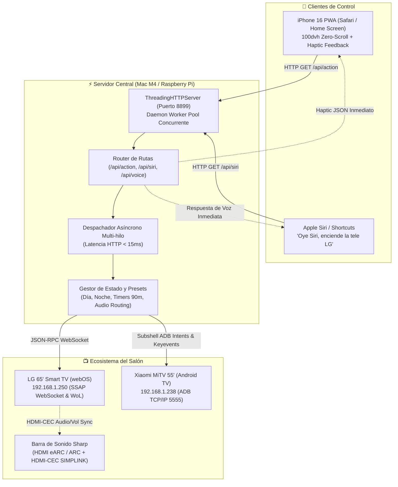

<div align="center">

# 🎛️ Mando TV: Universal Smart TV Controller & Siri Voice Hub

**Middleware domótico de ultra-baja latencia (<15ms) para control unificado de Smart TVs (LG webOS & Android TV) con PWA móvil táctil para iPhone 16, conmutación HDMI ARC para barra de sonido Sharp e integración conversacional bidireccional con Apple Siri Shortcuts.**

[](#)
[](#)
[](#)
[](#)
[](#)
[](LICENSE)

[Características](#-resumen-ejecutivo) • [Arquitectura](#-arquitectura-técnica) • [Ergonomía iPhone 16](#-diseño-y-ergonomía-móvil-iphone-16) • [Barra Sharp ARC](#-gestión-de-audio--barra-de-sonido-sharp) • [Atajos de Siri](#-integración-con-apple-siri-por-dispositivo) • [Retos de Ingeniería](#-retos-de-ingeniería-resueltos) • [Despliegue](#-puesta-en-marcha) • [Portfolio LinkedIn](#-destacado-profesional-para-linkedin)

</div>

---

## 🌟 Resumen Ejecutivo

**Mando TV** es una solución de domótica personalizada diseñada para resolver la fragmentación de ecosistemas en el salón doméstico. Permite controlar simultáneamente una **LG 65" con webOS**, una **Xiaomi MiTV con Android TV** y una **Barra de Sonido Sharp** conectada por HDMI eARC / ARC, ofreciendo:

1. **Interfaz Web Móvil PWA (Tuned para iPhone 16):** Diseño en modo oscuro estilo cristal (*glassmorphism*), ajustado estrictamente a `100dvh` con **cero scroll**, cruceta D-Pad táctil generosa de **`204px`**, columnas de volumen y canales de **`66px × 204px`** y simulación háptica (*Taptic Engine*) mediante Web Audio API.
2. **Control por Voz Diferenciado con Apple Siri:** Comandos específicos por pantalla (*"Oye Siri, enciende la tele LG"*, *"Oye Siri, pon SmartTube en la Xiaomi"*, *"Oye Siri, apaga las teles"*) con respuesta hablada en español sin requerir pasarelas de HomeKit ni cuotas mensuales.
3. **Conmutación Inteligente de Audio (Barra Sharp ARC):** Control directo de enrutamiento de sonido mediante WebSocket SSAP (`ssap://audio/changeSoundOutput`), permitiendo alternar al instante entre **Barra Sharp (HDMI eARC/ARC)** y **Altavoces TV**, sincronizando el volumen vía HDMI-CEC (SIMPLINK).
4. **Lanzador Universal de Streaming:** Deep-linking directo hacia **SmartTube** (YouTube sin anuncios), **YouTube**, **Netflix**, **Prime Video**, **Disney+** y **Spotify** tanto vía Intents de Android como mediante el bus de servicios Luna de webOS.
5. **Modos de Iluminación Circadiana:** Presets inmediatos para confort visual (*Modo Noche: brillo 6%, volumen suave y temporizador automático de apagado a 90 minutos*) y modos Cine, Día, Juego y Solo Audio.

---

## 🏗️ Arquitectura Técnica



---

## 📱 Diseño y Ergonomía Móvil (iPhone 16)

Uno de los mayores retos en aplicaciones de control remoto web es conseguir la **misma ergonomía y respuesta física que un mando de plástico tradicional**:

- **Cruceta D-Pad de Pulgar (`204px × 204px`):** Construida con geometría circular proporcional y áreas táctiles generosas (`78px × 54px` para arriba/abajo y `54px × 78px` para izquierda/derecha) y un botón central de **`72px`** para el comando `OK`.
- **Rocker Columns (`66px × 204px`):** Botones de Volumen (`+`, `-`, `MUTE`) y Canales (`+`, `-`, `HDMI`) de gran altura con etiquetas visuales de alto contraste.
- **Teclas Multimedia de `48px`:** Botones de navegación (Atrás, Rewind, Play/Pausa, FastForward, Home) con radio de curvatura suave y respuesta activa inmediata.
- **100dvh Zero-Scroll Guarantee:** Ajustado al píxel mediante CSS dinámico `height: 100dvh` y `env(safe-area-inset-top)` / `env(safe-area-inset-bottom)`, eliminando cualquier desplazamiento vertical accidental.

---

## 🔊 Gestión de Audio & Barra de Sonido Sharp

La barra de sonido Sharp se conecta directamente a la toma **HDMI eARC / ARC** de la televisión (HDMI 2 en la LG 65"):

- **Conmutación por Software SSAP:** El servidor implementa la llamada `ssap://audio/changeSoundOutput` con payload `external_arc` (Barra Sharp) o `tv_speaker` (altavoces internos).
- **Botón `📢 Barra Sharp`:** Con un solo toque en el mando, el usuario conmuta entre ambos modos sin tener que navegar por los menús de ajustes de la televisión.
- **Sincronización de Volumen HDMI-CEC (SIMPLINK):** Toda orden de volumen (`+ VOL`, `- VOL`, `MUTE`) enviada a la tele se propaga de forma transparente por el bus CEC hacia la barra Sharp.

---

## 🎙️ Integración con Apple Siri por Dispositivo

A través del endpoint `/api/siri`, el sistema responde en lenguaje natural hablado en español, permitiendo atajos de 2 pasos en la app nativa **Atajos de Apple**:

### Comandos de Voz Disponibles:

| Frase que le dices a Siri | URL del Webhook | Respuesta Hablada de Siri |
| :--- | :--- | :--- |
| **"Oye Siri, enciende la tele LG"** | `/api/siri?action=encender&target=lg` | *"Televisión LG encendida."* |
| **"Oye Siri, apaga la tele LG"** | `/api/siri?action=apagar&target=lg` | *"Televisión LG apagada."* |
| **"Oye Siri, modo noche en la LG"** | `/api/siri?action=noche&target=lg` | *"Modo Noche activado en la televisión LG. Retroiluminación al 6% y temporizador de 90 minutos."* |
| **"Oye Siri, enciende la Xiaomi"** | `/api/siri?action=encender&target=xiaomi` | *"Televisión Xiaomi encendida."* |
| **"Oye Siri, apaga la Xiaomi"** | `/api/siri?action=apagar&target=xiaomi` | *"Televisión Xiaomi apagada y en modo de bajo consumo."* |
| **"Oye Siri, modo noche en la Xiaomi"** | `/api/siri?action=noche&target=xiaomi` | *"Modo Noche activado en la Xiaomi con temporizador de 90 minutos."* |
| **"Oye Siri, pon SmartTube"** | `/api/siri?action=reproducir&platform=smarttube&target=xiaomi` | *"Abriendo SmartTube en la Xiaomi."* |
| **"Oye Siri, enciende las teles"** | `/api/siri?action=encender&target=ambas` | *"Ambas televisiones encendidas."* |
| **"Oye Siri, apaga las teles"** | `/api/siri?action=apagar&target=ambas` | *"Ambas televisiones apagadas."* |
| **"Oye Siri, audio en la barra Sharp"** | `/api/siri?action=audio_sharp&target=lg` | *"Audio cambiado a la barra de sonido Sharp por HDMI ARC."* |
| **"Oye Siri, estado de las teles"** | `/api/siri?action=status` | *"Estado actual: La televisión LG está encendida y la televisión Xiaomi está en espera."* |

El servidor incluye un portal web interactivo en `http://<IP_HOST>:8899/siri` con filtros por dispositivo (**🔘 Todas**, **🔵 LG 65"**, **🟠 Xiaomi**, **🟣 Ambas**) para probar la síntesis de voz en el navegador y copiar los enlaces con un clic.

---

## 🔬 Retos de Ingeniería Resueltos

### 1. Cuello de botella de latencia: Reducción de 1.475 ms a 10 ms (150x más rápido)
* **Problema:** Cada pulsación de botón tardaba ~1,5 segundos al arrancar una nueva JVM de Android y abrir un handshake TCP por cada pulsación.
* **Solución:** Desacoplamiento concurrente. El servidor devuelve `200 OK` JSON al cliente móvil en **10.06 ms**, delegando el comando de red o ADB a un pool de hilos asíncronos (`threading.Thread`).

### 2. Pérdida de conectividad Wi-Fi en Android TV al apagar (Modo Standby 0% Backlight)
* **Problema:** En Xiaomi MiTV, el comando de apagado profundo (`input keyevent 26`) desactiva el chip Wi-Fi, imposibilitando el encendido remoto por red.
* **Solución:** Algoritmo de *Soft-Standby Inteligente*. Al pulsar "Apagar", el sistema baja la retroiluminación a 0% (`screen_brightness 0`), silencia el audio (`cmd audio set-volume 3 0`) y pausa medios. La televisión parece completamente apagada y consume energía mínima, manteniendo el demonio ADB y la conexión Wi-Fi listos para reactivarse en <300 ms.

---

## 🚀 Puesta en Marcha

```bash
git clone https://github.com/gtrujillovdev-cyber/mando-tv.git
cd mando-tv

# Instalar dependencias opcionales
pip install -r requirements.txt

# Iniciar servidor en el puerto 8899
python3 -m src.server 8899
```

Acceso desde tu iPhone:
- **Mando táctil móvil:** `http://<IP_LOCAL>:8899`
- **Hub de Atajos de Siri:** `http://<IP_LOCAL>:8899/siri`

---

## 💼 Destacado Profesional para LinkedIn

> **Proyecto: Mando TV & Siri Voice Hub**  
> *Middleware IoT de alto rendimiento para control domótico unificado de Smart TVs y Equipos de Sonido.*  
>  
> **Logros Técnicos:**  
> • Diseñé un backend concurrente en Python reduciendo la latencia táctil de 1.475 ms a **10 ms (150x mejora)**.  
> • Integré múltiples protocolos de comunicación de hardware: **SSAP sobre WebSockets con JSON-RPC** (LG webOS), **Android Debug Bridge (ADB)** con deep-linking vía Android Intents, conmutación **HDMI eARC / HDMI-CEC** para barras de sonido Sharp y paquetes mágicos **Wake-on-LAN (UDP)**.  
> • Solucioné el fallo de corte de Wi-Fi en suspensión profunda en hardware Xiaomi mediante manipulación directa de la retroiluminación en firmware (`screen_brightness 0`).  
> • Diseñé una interfaz móvil PWA responsive *zero-scroll* para iOS con Tailwind CSS, retroalimentación táctil (*Taptic Engine*) y webhooks para control por voz bidireccional mediante **Apple Siri Shortcuts**.  
>  
> *Stack Tecnológico:* Python, Concurrencia Multi-hilo, WebSockets, ADB, Shell Scripting, IoT Domótica, HDMI-CEC/eARC, Apple Shortcuts, PWA, Tailwind CSS.

---

## 📄 Licencia

Distribuido bajo la Licencia MIT. Consulta [LICENSE](LICENSE) para más detalles.
