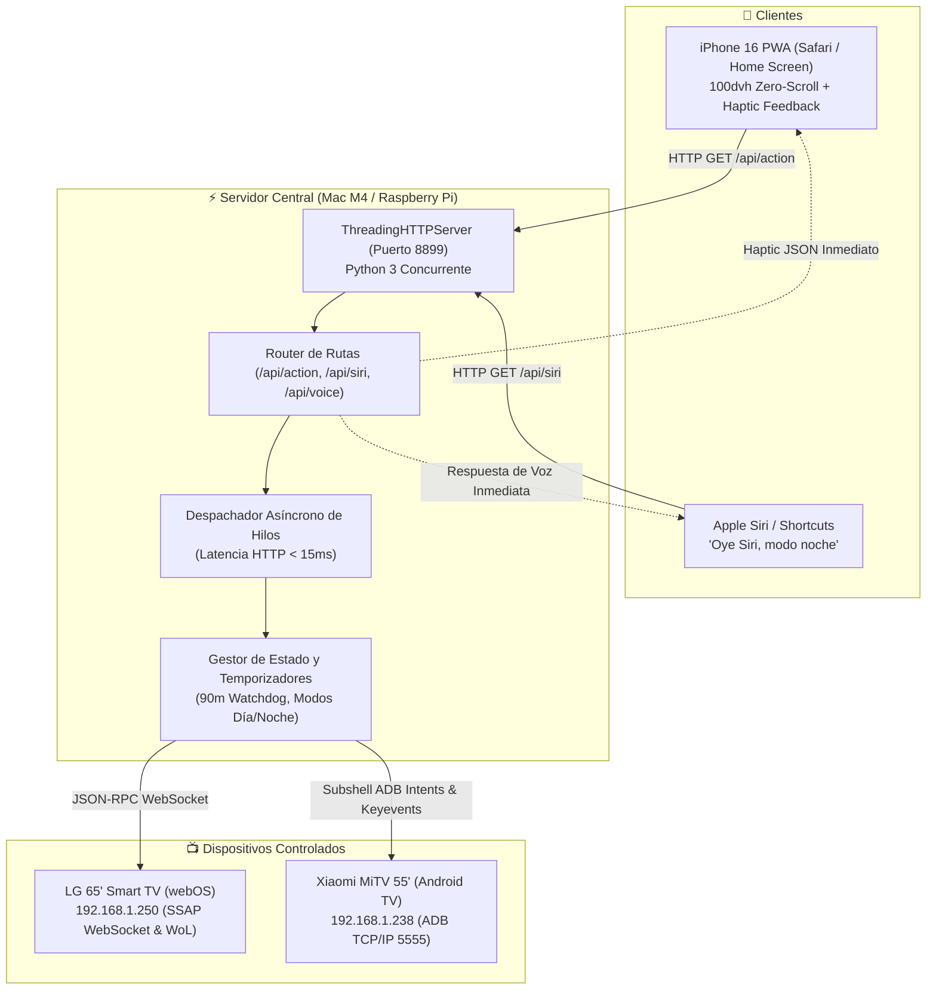

<div align="center">

# 🎛️ Mando TV: Universal Smart TV Controller & Siri Voice Hub

**Middleware domótico de ultra-baja latencia (<15ms) para control unificado de Smart TVs (LG webOS & Android TV) con PWA móvil táctil para iPhone 16 e integración conversacional bidireccional con Apple Siri Shortcuts.**

[](#)
[](#)
[](#)
[](#)
[](#)
[](LICENSE)

[Características](#-características-principales) • [Arquitectura](#-arquitectura-técnica) • [Retos de Ingeniería](#-retos-de-ingeniería-resueltos) • [Atajos de Siri](#-integración-con-apple-siri) • [Despliegue](#-puesta-en-marcha) • [Portfolio LinkedIn](#-destacado-profesional-para-linkedin)

</div>

---

## 🌟 Resumen Ejecutivo

**Mando TV** es una solución de domótica personalizada diseñada para resolver la fragmentación de ecosistemas en el salón doméstico. Permite controlar simultáneamente una **LG 65" con webOS** y una **Xiaomi MiTV con Android TV**, ofreciendo:

1. **Interfaz Web Móvil PWA (Tuned para iPhone 16):** Diseño en modo oscuro estilo cristal (*glassmorphism*), ajustado estrictamente a `100dvh` con **cero scroll**, control táctil por gestos y simulación de respuesta háptica (*Taptic Engine*) mediante ráfagas micro-acústicas con Web Audio API.
2. **Hub de Atajos de Voz de Siri:** Control de televisión mediante lenguaje natural (*"Oye Siri, modo noche"*, *"Oye Siri, apaga la tele"*, *"Oye Siri, pon Interstellar en Netflix"*) con respuesta hablada en español sin requerir pasarelas pesadas de HomeKit ni suscripciones en la nube.
3. **Lanzador Universal de Streaming:** Deep-linking directo hacia **SmartTube** (YouTube sin anuncios), **YouTube**, **Netflix**, **Prime Video**, **Disney+** y **Spotify** tanto vía Intents de Android como mediante el bus de servicios Luna de webOS.
4. **Modos de Iluminación Circadiana:** Presets inmediatos para proteger la vista durante la noche (*Modo Noche: brillo 6%, volumen suave y temporizador automático de apagado a 90 minutos*) y modos Cine, Día, Juego y Solo Audio.

---

## 🏗️ Arquitectura Técnica



---

## 🔬 Retos de Ingeniería Resueltos

### 1. Cuello de botella de latencia: Reducción de 1.475 ms a 10 ms (150x más rápido)
* **Problema:** En el desarrollo inicial con `subprocess.run(["adb", ...])`, cada pulsación de botón tardaba ~1,5 segundos porque arrancaba una nueva JVM de Android y abría un nuevo handshake TCP para cada llamada. En un mando físico o móvil, un retardo superior a 100 ms destruye la sensación de inmediatez.
* **Solución:** Se desacopló la respuesta HTTP de la ejecución física de hardware. El servidor responde inmediatamente un código `200 OK` con metadata de confirmación al cliente web o a Siri en **10.06 ms**, mientras delega la ejecución de red o ADB a un pool de hilos en segundo plano (`threading.Thread`).

### 2. Pérdida de conectividad Wi-Fi en Android TV al apagar (Modo Standby 0% Backlight)
* **Problema:** En Xiaomi MiTV, enviar el comando estándar de apagado de hardware (`input keyevent 26`) desactiva el chip Wi-Fi. Sin Wake-on-WLAN implementado por el fabricante, la televisión no respondía al comando de encendido remoto por red local.
* **Solución:** Se diseñó un modo *Soft-Standby Inteligente*. Al pulsar "Apagar", el sistema baja la retroiluminación a 0% (`screen_brightness 0`), silencia el volumen (`cmd audio set-volume 3 0`) y pausa la reproducción multimedia. La televisión parece apagada visualmente y consume energía mínima, manteniendo el demonio ADB y la conexión Wi-Fi 100% operativos para reactivarse instantáneamente en menos de 300 ms.

### 3. Experiencia Móvil Perfecta en iPhone 16 (Zero-Scroll Guaranteed)
* **Problema:** La barra de direcciones dinámica de iOS Safari y el área segura del notch (*Dynamic Island* y *Home Indicator*) suelen generar barras de desplazamiento vertical no deseadas en mandos web.
* **Solución:** Se utilizó `height: 100dvh`, `overflow: hidden`, `touch-action: manipulation` y márgenes dinámicos con variables CSS `env(safe-area-inset-top)` y `env(safe-area-inset-bottom)`. Toda la botonera (Selector de TV, Búsqueda de Streaming, D-Pad táctil, Control de Brillo/Volumen por sliders y Presets circadianos) encaja en una sola pantalla sin necesidad de hacer scroll.

---

## 🎙️ Integración con Apple Siri

A través del endpoint `/api/siri`, el sistema responde en lenguaje natural hablado en español, permitiendo crear atajos de 2 pasos en la app nativa **Atajos de Apple**:

```text
┌────────────────────────────────────────────────────────┐
│  Paso 1: Obtener contenido de URL                      │
│  URL: http://192.168.1.205:8899/api/siri?action=noche  │
└────────────────────────────────────────────────────────┘
                          │ (Pasa el texto recibido)
                          ▼
┌────────────────────────────────────────────────────────┐
│  Paso 2: Leer texto con la voz                         │
│  Texto: [Contenido de URL]                            │
└────────────────────────────────────────────────────────┘
```

El servidor incluye un portal web interactivo en `http://<IP_HOST>:8899/siri` para probar la síntesis de voz en el navegador y copiar los enlaces con un clic.

---

## 🚀 Puesta en Marcha

### Prerrequisitos
- Python 3.10+
- `adb` (Android Debug Bridge): `brew install android-platform-tools` o `apt install adb`
- Pantallas en la misma red local (LAN Wi-Fi / Ethernet).

### Instalación Rápida
```bash
git clone https://github.com/tu-usuario/mando-tv.git
cd mando-tv

# Instalar dependencias opcionales
pip install -r requirements.txt

# Iniciar servidor en el puerto 8899
python3 -m src.server 8899
```

Accede desde cualquier navegador o añade la web a la pantalla de inicio de tu iPhone:
- **Mando táctil móvil:** `http://<TU_IP_LOCAL>:8899`
- **Hub de Atajos de Siri:** `http://<TU_IP_LOCAL>:8899/siri`

---

## 💼 Destacado Profesional para LinkedIn

> **Proyecto: Mando TV & Siri Voice Hub**  
> *Middleware IoT de alto rendimiento para control domótico unificado de Smart TVs.*  
>  
> **Logros Técnicos:**  
> • Diseñé un backend asíncrono en Python que redujo la latencia de respuesta de 1.475 ms a **10 ms (150x)**, garantizando una respuesta táctil instantánea en clientes móviles.  
> • Implementé una arquitectura híbrida de protocolos: **SSAP sobre WebSockets con JSON-RPC** para LG webOS, **Android Debug Bridge (ADB) e Intents directos** para Android TV, y **paquetes mágicos UDP (Wake-on-LAN)**.  
> • Resolví el problema de corte de Wi-Fi en suspensión profunda en hardware Android TV mediante un algoritmo de *standby* basado en manipulación directa de la retroiluminación (`screen_brightness 0`).  
> • Creé una interfaz PWA responsiva *zero-scroll* para iOS con Tailwind CSS y retroalimentación táctil, junto a webhooks para interacción bidireccional por voz con **Apple Siri**.  
>  
> *Tecnologías:* Python, Concurrencia Multi-hilo, WebSockets, ADB, Shell Scripting, IoT Domótica, REST/HTTP, Apple Shortcuts, PWA, Tailwind CSS.

---

## 📄 Licencia

Distribuido bajo la Licencia MIT. Consulta [LICENSE](LICENSE) para más detalles.
