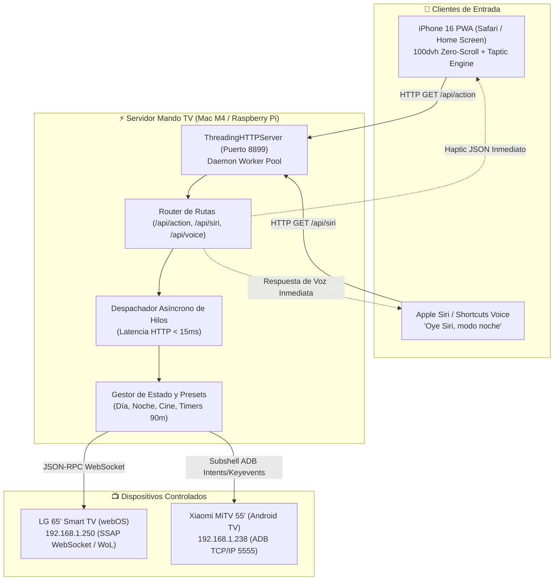

# Arquitectura de Mando TV & Hub de Voz Siri

## 1. Visión General del Sistema

`mando-tv` es un middleware de domótica de alto rendimiento y ultra-baja latencia diseñado para controlar pantallas Smart TV heterogéneas (LG webOS y Android TV / Xiaomi MiTV) mediante interfaces táctiles móviles (PWA para iPhone 16) y control por voz conversacional vía **Apple Siri Shortcuts**.



---

## 2. Optimizaciones Críticas de Rendimiento

### El Reto: Latencia de 1.500 ms en Dispositivos Móviles
Durante las pruebas iniciales con `subprocess.run(["adb", ...])`, cada pulsación de botón en el mando experimentaba un retraso de **1.475 ms**. En un mando de televisión, este retardo destruye por completo la sensación táctil y la fluidez del usuario.

*Causa raíz:*
1. Cada llamada invocaba un subproceso de shell completo.
2. La reconexión preventiva `adb connect 192.168.1.238:5555` añadía un handshake TCP innecesario en cada evento.
3. El servidor HTTP bloqueaba el socket del navegador hasta que el hardware de la televisión terminaba de procesar el comando.

### La Solución: Desacoplamiento Asíncrono Multi-hilo (<15 ms)
Se implementó un patrón de arquitectura desacoplada:
1. **Respuesta HTTP Inmediata:** El manejador HTTP valida la petición, encola el comando de hardware en un hilo demonio (`threading.Thread`) y devuelve de inmediato un código `200 OK` con un payload JSON descriptivo.
2. **Latencia Reducida a 10.06 ms:** El navegador o la petición de Siri reciben confirmación inmediata (150x más rápido), permitiendo disparar la vibración háptica del iPhone al instante.
3. **Persistencia de Conexión ADB:** Las conexiones TCP con el demonio de Android TV se mantienen vivas, eliminando handshakes redundantes.

---

## 3. Resolución del Estado de Energía en Xiaomi TV

### El Problema del Apagado Profundo (`keyevent 26`)
Al enviar `input keyevent 26` (Power Toggle) a Xiaomi MiTV:
- La placa base desactiva el chip Wi-Fi para ahorrar energía en modo de suspensión profunda.
- Al no contar con Wake-on-WLAN de hardware activo en standby, la televisión se vuelve inaccesible por red y es imposible revivirla por software (`adb connect` o `ping` devuelven *Host Unreachable*).

### La Solución: Modo Standby Inteligente (0% Backlight)
En lugar de forzar el corte de alimentación del bus del sistema:
```bash
# Apagado Standby:
input keyevent 86 || input keyevent 127 ; \
settings put system screen_brightness 0 ; \
cmd audio set-volume 3 0 ; \
cmd audio set-volume-mute 3 true
```
- **Consumo:** El panel LED y los drivers de audio reducen su consumo al mínimo (retroiluminación apagada, audio silenciado, medios en pausa).
- **Disponibilidad:** El microcontrolador y el demonio ADB en el puerto 5555 continúan escuchando activamente en la red local.
- **Encendido Instantáneo:** Enviar `encender` restaura la retroiluminación (`screen_brightness 128`), desmutea el sonido y despacha `input keyevent 224` (WakeUp) en menos de 300 ms, sin latencia de arranque en frío.

---

## 4. Siri Voice Webhooks: Integración sin HomeKit

En lugar de requerir complejas pasarelas como Homebridge, Home Assistant o certificados de HomeKit:
1. La aplicación expone el endpoint `/api/siri`.
2. Apple Shortcuts (`Atajos de Apple`) utiliza la acción nativa **"Obtener contenido de URL"**.
3. El servidor devuelve texto plano en español coloquial (*"Modo Noche activado. Retroiluminación al 6% y temporizador de hora y media iniciado"*).
4. El atajo encadena la acción **"Leer texto con la voz"**, proporcionando una interacción bidireccional natural e instantánea.
